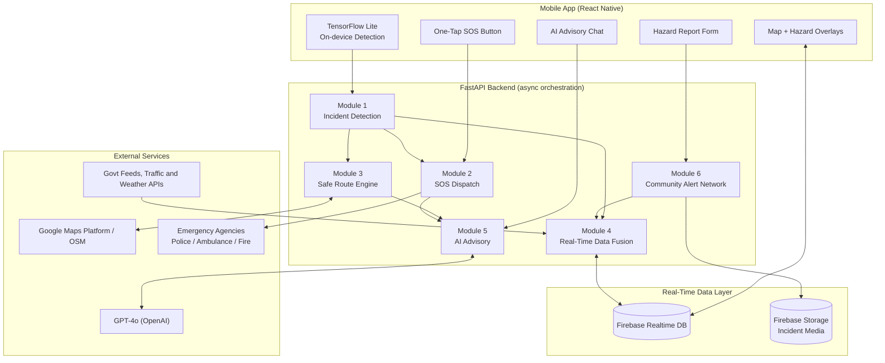
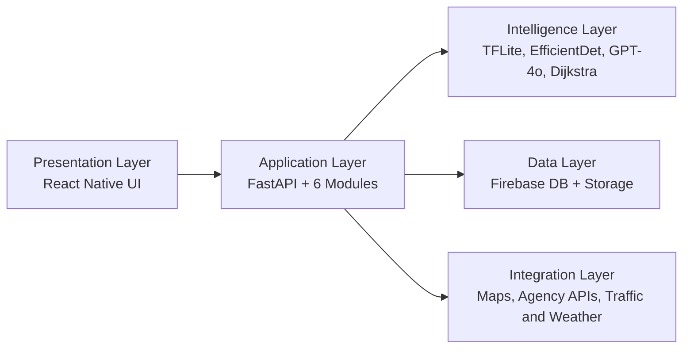
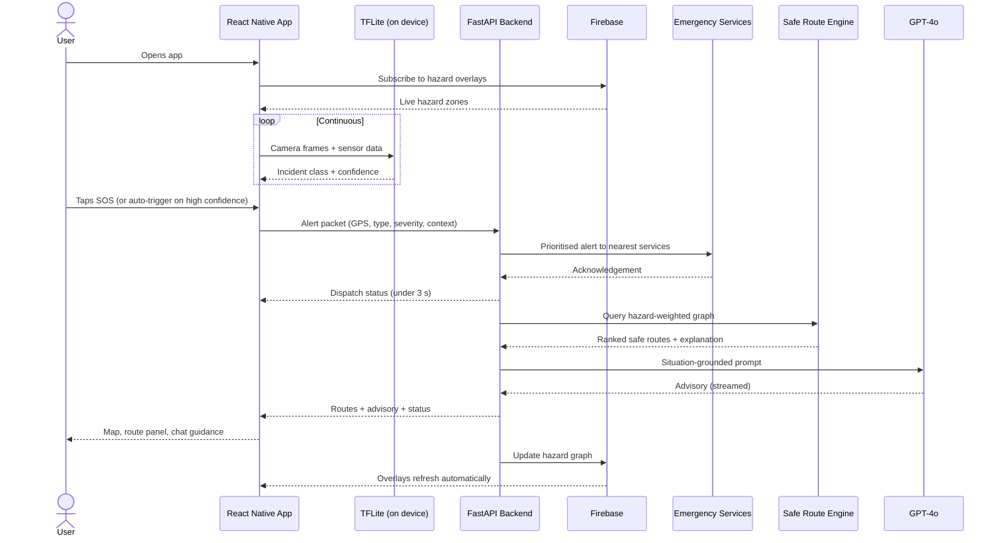
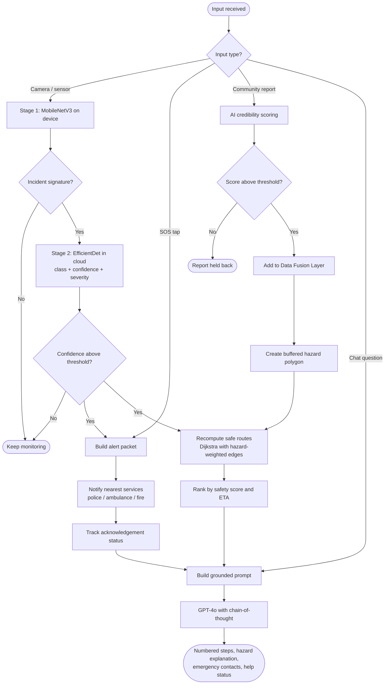
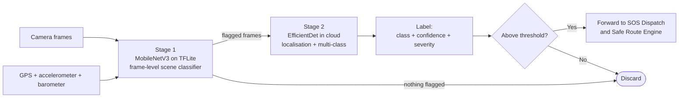
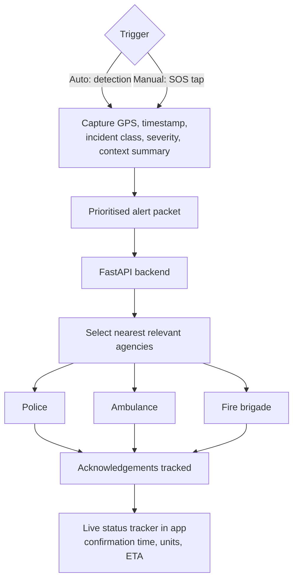
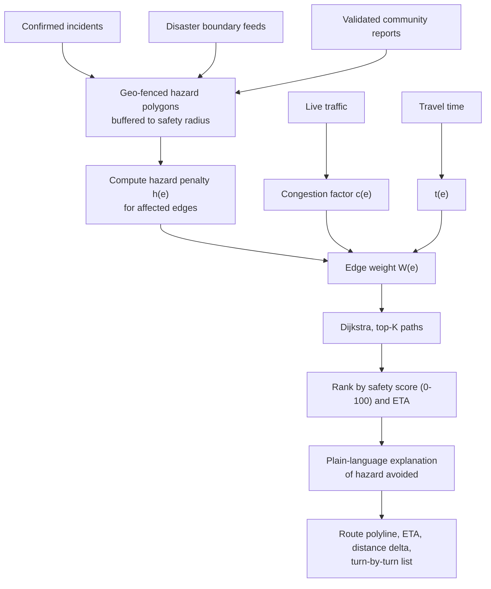
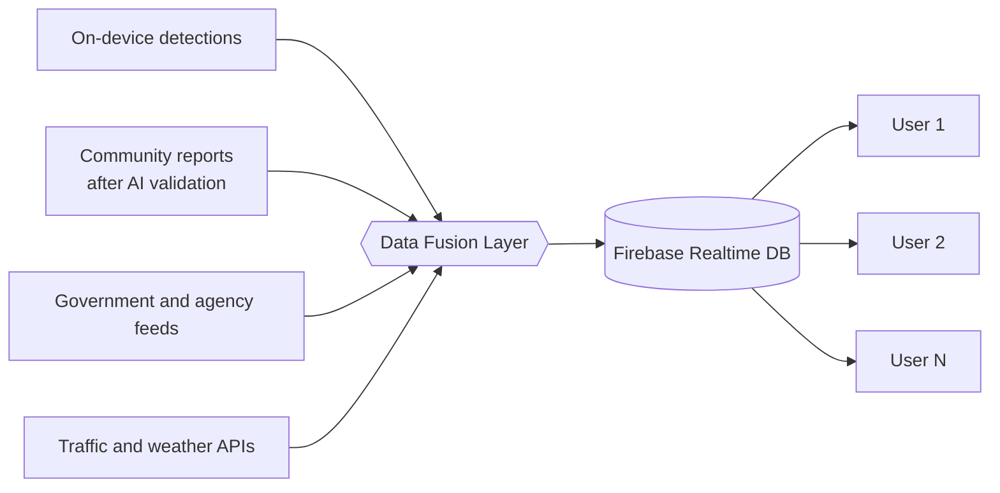
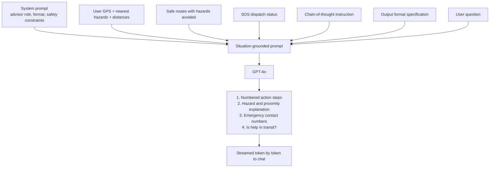
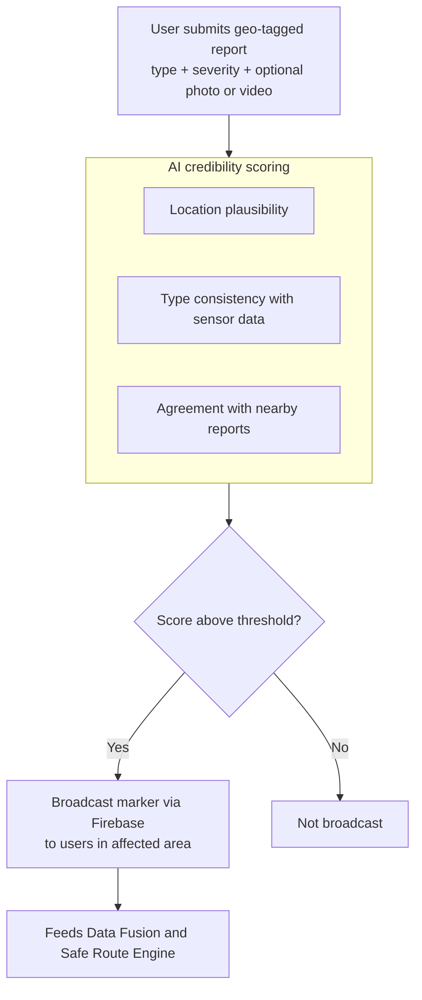

# SafePath AI

**A Smart Emergency and Intelligent Navigation Platform**

SafePath AI is a mobile safety platform that detects hazards, dispatches SOS alerts, reroutes users around danger zones, and gives step-by-step emergency guidance in plain language. A user opens one app and gets the whole emergency lifecycle: detection, dispatch, safe routing, advisory and community alerts. The system fuses camera and sensor data, community reports and agency feeds into one live hazard picture, and uses GPT-4o to write advice grounded in that picture.

Example: a user near a flooded underpass taps SOS. The app captures GPS, time and incident context, alerts the nearest emergency services, draws a safe alternative route that avoids the flood polygon, and the advisory chat explains what to do next and why that route was chosen.

## Contents
1. Key features
2. System architecture
3. How it works
4. The six modules in detail
5. Use cases
6. Technology stack
7. Requirements
8. Evaluation
9. Limitations
10. Future scope

---

## 1. Key features

| Feature | What it does |
|---|---|
| One-tap SOS | Single interaction captures GPS, timestamp and incident context and starts dispatch. |
| Real-time hazard detection | Classifies accidents, floods, fires and road blockages from camera and sensor data. |
| Hazard-aware routing | Computes safe alternative paths that avoid live hazard zones using weighted Dijkstra. |
| Grounded AI advisory | GPT-4o sees live location, hazards, routes and SOS status before it answers. |
| Community Alert Network | Users report hazards; an AI credibility score filters noise before broadcast. |
| Real-time sync | Firebase pushes hazard updates to all active users in under a second. |
| Offline resilience | TensorFlow Lite runs detection and SOS on the device without network. |
| Explainable routes | Every route recommendation names the hazard it avoids, in plain language. |

---

## 2. System architecture

### 2.1 High-level architecture



**How to read it:** the phone captures input (camera, SOS tap, chat, reports). FastAPI runs the six modules. Firebase is the shared live state that every phone reads from. External services supply maps, language intelligence and the emergency agencies.

### 2.2 Components

| Component | Technology | Responsibility |
|---|---|---|
| Mobile frontend | React Native 0.73+ | Map, SOS panel, route panel, advisory chat, report form |
| Backend API | FastAPI (Python 3.10+) | Asynchronous orchestration of all six modules |
| Geospatial services | Google Maps Platform, OpenStreetMap | Live traffic, geocoding, road graph, geofencing |
| Real-time layer | Firebase Realtime DB | Sub-second hazard propagation to all sessions |
| Media storage | Firebase Storage | User-submitted photos and videos |
| On-device AI | TensorFlow Lite (MobileNetV3) | Offline frame-level incident classification |
| Cloud vision | EfficientDet | Precise localisation and multi-class classification |
| Advisory LLM | GPT-4o | Conversational, situation-grounded guidance |
| Routing algorithm | Dijkstra on weighted directed graph | Top-K safe alternatives |

### 2.3 Layered view



---

## 3. How it works

### 3.1 End-to-end request flow



### 3.2 Decision flow inside the backend



### 3.3 Step by step

1. **Open the app.** The map loads with live hazard overlays from Firebase.
2. **Monitor continuously.** The on-device TFLite model analyses camera frames and sensor data (GPS, accelerometer, barometer) for incident signatures.
3. **Trigger.** A high-confidence detection or a manual SOS tap sends a structured alert to FastAPI.
4. **Dispatch.** The backend finds the nearest relevant services and forwards location and incident context.
5. **Reroute.** The Safe Route Engine queries the hazard-weighted graph and returns ranked safe alternatives.
6. **Advise.** The AI Advisory Module builds a situation-grounded prompt and calls GPT-4o.
7. **Stream.** The response streams back through FastAPI into the chat panel token by token.
8. **Community.** User reports are validated by the credibility model and broadcast through Firebase to nearby users.
9. **Fuse.** The Data Fusion Layer keeps updating the hazard graph as new data arrives.
10. **Refresh.** Map overlays and route recommendations update automatically.

### 3.4 Key parameters and targets

| Parameter | Value | Module |
|---|---|---|
| SOS alert latency target | under 3 s | SOS Dispatch |
| Route recomputation target | under 2 s | Safe Route Engine |
| Detection precision target | at least 85% | Incident Detection |
| Severity levels | low, medium, high, critical | Incident Detection |
| Detection classes | accident, flood, fire, blockage | Incident Detection |
| Edge weight tunables | alpha, beta, gamma | Safe Route Engine |
| Hazard buffer | configurable safety radius | Safe Route Engine |
| Detection confidence threshold | configurable | Incident Detection |

---

## 4. The six modules in detail

### 4.1 Module 1: Incident Detection

Takes camera frames and sensor streams and produces a classified incident with confidence and severity. It runs in two stages so the phone can work offline while the cloud adds precision.



### 4.2 Module 2: SOS Dispatch

Triggered automatically on a high-confidence detection or manually by the one-tap button.



### 4.3 Module 3: Safe Route Engine

The road network is a weighted directed graph G = (V, E, W). Each road segment gets a composite cost:

```
W(e) = alpha * t(e) + beta * h(e) + gamma * c(e)
```

- `t(e)` is estimated travel time.
- `h(e)` is the hazard penalty for edges inside or next to an active hazard zone.
- `c(e)` is the congestion factor from live traffic.
- `alpha`, `beta`, `gamma` are tunable weights that trade speed against safety.



### 4.4 Module 4: Real-Time Data Fusion Layer



Every active session reads the same hazard picture, so all users see consistent overlays and route advice.

### 4.5 Module 5: AI Advisory

The LLM never answers in a vacuum. The prompt is built from live context so advice is specific to the user's situation.



### 4.6 Module 6: Community Alert Network



---

## 5. Use cases

| Use case | Scenario | Behaviour |
|---|---|---|
| Road accident | User witnesses or is in a crash | Detects, auto or manual SOS, ambulance and police notified, advisory guides first steps |
| Flood | Flash flood on the planned route | Polygon created, route recalculated around it, explanation names the flood |
| Fire | Fire near the user's location | Fire brigade alerted, evacuation route shown, advisory lists actions |
| Road blockage | Blocked road ahead | Rerouted with ETA and distance delta |
| Crowd report | A user spots a hazard no sensor sees | Report scored, validated, broadcast to nearby users |
| Low connectivity | Network drops | On-device detection and SOS keep working in degraded mode |

---

## 6. Technology stack

| Layer | Technology | Purpose |
|---|---|---|
| Mobile | React Native v0.73+ | Cross-platform iOS and Android app |
| Backend | FastAPI, Python 3.10+ | Async API and AI pipeline orchestration |
| Maps | Google Maps Platform, OpenStreetMap | Routing, traffic, geocoding, geofencing |
| Real-time DB | Firebase Realtime Database | Sub-second alert propagation |
| Storage | Firebase Storage | Incident media |
| On-device AI | TensorFlow Lite, MobileNetV3 | Offline classification |
| Cloud vision | EfficientDet | Localisation and multi-class detection |
| LLM | GPT-4o (OpenAI) | Advisory generation |
| Tools | Git/GitHub, Postman/Swagger UI, VS Code, Android Studio | Development and testing |

---

## 7. Requirements

### 7.1 Functional

| ID | Requirement |
|---|---|
| FR01 | One-tap SOS with auto-captured GPS, timestamp and context |
| FR02 | Automated dispatch to nearest police, ambulance, fire |
| FR03 | Real-time hazard detection from camera and sensors |
| FR04 | Safe route computation avoiding live hazard zones |
| FR05 | Geo-tagged community hazard reports with optional media |
| FR06 | AI credibility scoring before broadcast |
| FR07 | Live hazard map overlay |
| FR08 | AI advisory chat grounded in live context |
| FR09 | Offline on-device detection |
| FR10 | Multi-agency alert coordination with status tracking |

### 7.2 Non-functional

| ID | Requirement | Target |
|---|---|---|
| NFR01 | Alert latency | under 3 s |
| NFR02 | Route computation | under 2 s |
| NFR03 | Detection precision | at least 85% |
| NFR04 | Availability | Async concurrent request handling |
| NFR05 | Offline resilience | Core SOS and detection work offline |
| NFR06 | Scalability | City-scale users via Firebase scaling |
| NFR07 | Usability under stress | Single tap, no forms |
| NFR08 | Explainability | Plain-language reason for every route |

### 7.3 Hardware

- Development machine: 16 GB RAM, hexa-core CPU, 100 GB free storage
- Phone: Android 10+ or iOS 14+ with GPS, camera and accelerometer (GPS only for minimal SOS)
- Network: 4G/LTE in production, graceful degradation to 3G
- Server: cloud host with Python 3.10+ and GPU access for model serving

---

## 8. Evaluation

| Test | Result | Target |
|---|---|---|
| Detection precision (2,000 test images, 4 classes) | 87.3% | at least 85% |
| Detection recall | 84.6% | n/a |
| Best class: road accidents | 91.2% precision | n/a |
| Weakest class: road blockages | 82.1% precision | n/a |
| Route computation after hazard update | 1.4 s average | under 2 s |
| Route quality (50 simulated hazard scenarios) | All alternatives avoided the hazard | 100% |
| SOS latency on 4G | 1.8 s average | under 3 s |
| Community report validation (300 synthetic reports) | 92% genuine reports validated | n/a |
| False-positive broadcast rate | below 6% | n/a |
| Functional testing | All six modules passed end to end | n/a |

---

## 9. Limitations

- **Generalisation.** The detection model may underperform on incident types or environments missing from the training data.
- **LLM latency.** GPT-4o adds 2 to 4 seconds, which matters in the most urgent moments.
- **Network dependency.** SOS and on-device detection work offline, but safe routing and community broadcasting need connectivity.
- **Agency integration.** Fully automated dispatch needs formal API agreements with emergency agencies, still pending approval.
- **Synthetic validation data.** Community report validation was tested on synthetic reports, not live traffic.

---

## 10. Future scope

- Wearable integration (smartwatches and fitness bands) for hands-free detection
- Drone-assisted hazard confirmation and search and rescue
- Predictive hazard modelling for floods, fires and congestion
- Multilingual advisory: Kannada, Hindi, Tamil, Telugu
- Integration with NDMA, state disaster authorities and traffic control
- Standardised benchmarks for end-to-end response time and route safety
